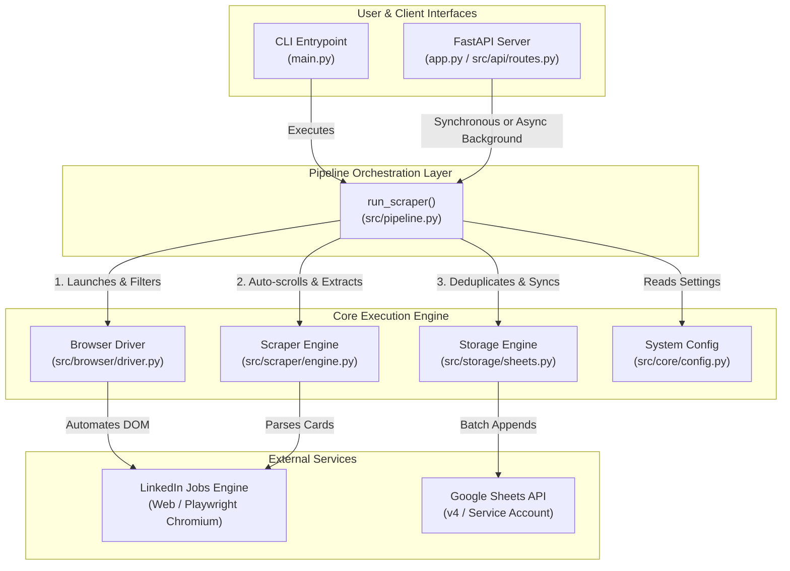
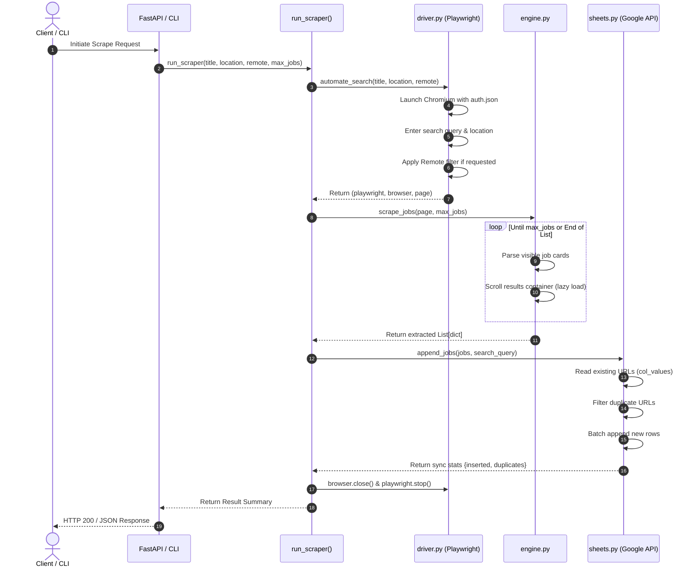

# LinkedIn Job Scraper: Main Implementation Guide

This document provides a comprehensive technical breakdown of the **LinkedIn Job Scraper & Google Sheets Synchronizer** system architecture, component internals, execution lifecycles, and operational procedures.

---

## 1. System Architecture

The application is structured into decoupled, single-responsibility layers:



---

## 2. Component Internals & Module Breakdown

### 2.1 Configuration Layer (`src/core/config.py`)
- **Pattern**: Centralized frozen dataclass (`Settings`) loaded once at startup.
- **Environment Hydration**: Leverages `python-dotenv` to inspect `.env` and host environment variables.
- **Cloud Auto-Detection**: Inspects `RENDER` or `CI` environment flags. When active, it defaults `HEADLESS = True` to prevent headless Linux display crashes.

```python
# Environment variables mapped:
HEADLESS           # bool: Run browser invisibly (default: True in cloud, False locally)
BROWSER            # str: 'chromium'
DEFAULT_TIMEOUT    # int: Milliseconds for DOM waits (default: 10000)
MAX_JOBS           # int: Default scraping limit (default: 50)
LINKEDIN_AUTH_FILE # str: Local path to auth.json (default: 'auth.json')
LINKEDIN_AUTH      # str: JSON string containing storage_state for cloud envs
GOOGLE_SHEET_NAME  # str: Target spreadsheet title (default: 'LinkedIn Job Scraper')
GOOGLE_CREDS_FILE  # str: Local service account file (default: 'credentials.json')
GOOGLE_CREDENTIALS # str: JSON string containing service account for cloud envs
```

---

### 2.2 Browser & Session Driver (`src/browser/driver.py`)
Responsible for browser context provisioning, session restoration, and search query execution.

#### A. Session Restoration Hierarchy
1. Checks for local `auth.json` on disk.
2. If missing, checks the `LINKEDIN_AUTH` environment variable and writes it into memory/file.
3. Raises `FileNotFoundError` with interactive instructions if neither exists.

#### B. Anti-Detection Flags & Lifecycle Guarantee
The browser launches Chromium with essential flags for stability and stealth:
- `--no-sandbox` & `--disable-setuid-sandbox`: Necessary for Docker / containerized execution.
- `--disable-dev-shm-usage`: Uses `/tmp` instead of shared memory to prevent out-of-memory crashes on small cloud instances.
- `--disable-blink-features=AutomationControlled`: Disables the Chromium `navigator.webdriver` flag.
- Custom User-Agent matching desktop Chrome on Windows.

#### C. Clean Resource Teardown
If any exception occurs during navigation, location typing, or filter toggling, an internal `except` block closes `browser` and stops `playwright` before re-raising the error. This eliminates orphaned Chromium processes in memory.

---

### 2.3 Scraper & Extraction Engine (`src/scraper/engine.py`)
Extracts structured job records from LinkedIn's search results page.

#### A. Container Auto-Scrolling (Virtual DOM Handling)
LinkedIn only mounts 7–25 cards in the DOM at initial load. The scraper implements an incremental scrolling loop:
1. Inspects the cards container: `.jobs-search-results-list, .scaffold-layout__list`.
2. Progressively triggers `scrollBy(0, 1000)` on the container.
3. Tracks stagnant scroll cycles: if no new cards appear after multiple scroll attempts, it concludes the feed has ended.
4. Stops immediately once `len(jobs) >= max_jobs`.

#### B. Multi-Strategy Title Extraction
To avoid blank titles or corrupted text due to "Promoted", "Verified", or "Easy Apply" badges:
- **Strategy 1**: Looks for `span[aria-hidden='true']` inside the primary title paragraph.
- **Strategy 2**: Inspects raw inner text of paragraph 0 and strips regular expressions like `\s*\(Verified job\)`.
- **Strategy 3**: Inspects the dismiss button's accessibility label:
  ```python
  re.search(r"Dismiss\s+(.*?)\s+job", aria_label, flags=re.I)
  ```
- **Strategy 4**: Directly queries anchor links pointing to `/jobs/view/`.

#### C. Job ID Extraction
Resolves numeric job IDs through:
1. `componentkey` attribute regex: `(\d+)$`
2. `data-occludable-job-id` attribute.
3. Target URL href regex: `/jobs/view/(\d+)`.

---

### 2.4 Persistence Layer (`src/storage/sheets.py`)
Synchronizes scraped jobs to Google Sheets via `gspread`.

#### A. Dual Credential Resolution
Seamlessly switches between local file `credentials.json` and the stringified `GOOGLE_CREDENTIALS` environment variable (Render production).

#### B. High-Performance Deduplication
- Instead of downloading the entire worksheet with `get_all_values()`, it dynamically identifies the **"Job URL"** column index and retrieves only that column via `sheet.col_values(url_col_idx)`.
- Compares each scraped URL against `existing_urls` in $O(1)$ set lookup time.

#### C. Batched Write Operations
Consolidates all newly discovered records into a single `sheet.append_rows(rows_to_insert)` API call, preserving Google API quotas (60 writes/minute limit).

#### D. Schema Format
Automatically initializes empty worksheets with structured tabular headers:
| Scraped At | Search Query | Title | Company | Location | Job URL |
| :--- | :--- | :--- | :--- | :--- | :--- |
| `2026-11-04 18:30:00` | `AI Engineer \| SF (Remote: yes)` | Senior AI Engineer | OpenAI | San Francisco, CA | `https://www.linkedin.com/jobs/view/12345/` |

*(Also retains backward compatibility if connecting to legacy 4-column sheets).*

---

### 2.5 REST API Layer (`src/api/`)
Provides a web service interface built on FastAPI.

- **`GET /health`**: Health status and configuration sanity.
- **`POST /scrape`**: Synchronous pipeline execution (waits for full completion).
- **`POST /scrape/async`**: Asynchronous background job trigger using FastAPI `BackgroundTasks`. Returns HTTP `202 Accepted` with a unique `task_id` (`UUIDv4`).
- **`GET /tasks/{task_id}`**: Polling endpoint returning task state: `"queued"`, `"running"`, `"completed"`, or `"failed"`.

---

## 3. End-to-End Execution Flow



---

## 4. Operational Playbook

### 4.1 Local Development Workflow
```bash
# 1. Activate Virtual Environment
source venv/bin/activate  # Or .\venv\Scripts\Activate.ps1 on Windows

# 2. Run initial login generator
python login.py

# 3. Test Google Sheets connectivity
python scripts/test_sheets.py

# 4. Run automated test suite
python -m unittest discover tests

# 5. Execute scraper via CLI
python main.py

# 6. Or run API server locally
uvicorn app:app --reload --port 8000
```

---

### 4.2 Production Deployment (Render)

#### Step 1: Build & Start Configuration
- **Build Command**:
  ```bash
  chmod +x build.sh && ./build.sh
  ```
- **Start Command**:
  ```bash
  uvicorn app:app --host 0.0.0.0 --port $PORT
  ```

#### Step 2: Set Environment Variables
In the Render Web Service Dashboard (Environment tab):
| Variable | Value | Notes |
| :--- | :--- | :--- |
| `HEADLESS` | `true` | Required for headless container instances |
| `LINKEDIN_AUTH` | `{ "cookies": [...], "origins": [...] }` | Stringified JSON of local `auth.json` |
| `GOOGLE_CREDENTIALS` | `{ "type": "service_account", ... }` | Stringified JSON of `credentials.json` |
| `GOOGLE_SHEET_NAME` | `LinkedIn Job Scraper` | Target sheet name |

---

## 5. Security & Best Practices

1. **Credentials Isolation**:
   - `auth.json` and `credentials.json` are excluded via `.gitignore`.
   - Never commit sensitive session cookies or private keys to source control.
2. **Datacenter IP Detection**:
   - LinkedIn monitors automated traffic from cloud IP ranges.
   - For long-term production resilience, initiate runs with realistic `DEFAULT_TIMEOUT` intervals and use the async task queue (`/scrape/async`) to avoid timing out HTTP proxies.
3. **Google API Quota Defense**:
   - Appending is strictly batched using `sheet.append_rows()`.
   - Queries fetch single columns rather than parsing full grid dimensions.
